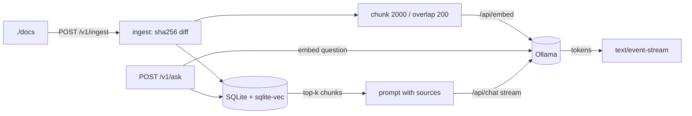

# local-llm-rag

Fully offline RAG over your files with Ollama and sqlite-vec — no cloud APIs.

[](https://github.com/Muhaman/local-llm-rag/actions/workflows/ci.yml)

## What it does

Point it at a folder of `.md`, `.txt` and `.pdf` files. It chunks and embeds them with a local Ollama model, stores the vectors in a single SQLite file, and answers questions with a local chat model, streaming the answer over Server-Sent Events and citing sources as `[path]`. Nothing leaves your machine.

## Architecture



## Quickstart

```bash
docker compose up --build        # pulls qwen2.5:7b + nomic-embed-text on first run
curl -X POST localhost:8000/v1/ingest
open http://localhost:8000       # or use the API below
```

Put your own files in `./docs` (two synthetic samples are included). Models and paths are configured through environment variables:

| Variable | Default |
|---|---|
| `OLLAMA_URL` | `http://ollama:11434` |
| `CHAT_MODEL` | `qwen2.5:7b` |
| `EMBED_MODEL` | `nomic-embed-text` |
| `EMBED_DIM` | `768` (must match the embedding model) |
| `DOCS_DIR` | `/data/docs` |
| `DB_PATH` | `/data/index.db` |
| `TOP_K` | `5` |

Without Docker: run Ollama locally, `uv sync`, then `OLLAMA_URL=http://localhost:11434 DOCS_DIR=./docs DB_PATH=./index.db uv run uvicorn localrag.api:app`.

## Usage

```bash
curl -X POST localhost:8000/v1/ingest
# {"added":2,"updated":0,"skipped":0,"removed":0}

curl -N -X POST localhost:8000/v1/ask \
  -H 'content-type: application/json' \
  -d '{"question": "How long is the panel warranty?"}'
# data: {"token": "Sunbeam"}
# ...
# event: done
# data: {}
```

Errors always use `{"error": {"code": "...", "message": "..."}}`. Failures during a stream arrive as an `event: error` frame. `GET /healthz` returns 503 when Ollama is unreachable.

## Design decisions & trade-offs

- **One SQLite file for everything.** Documents, chunks and the `vec0` vector table live in `index.db`; no separate vector database to run.
- **Content hashing for incremental sync.** Each file is sha256-hashed; unchanged files are skipped, edited files are re-embedded, vanished files are removed.
- **Fixed-size character chunks.** Simple and predictable; overlap keeps sentences that straddle a boundary retrievable. No sentence or heading awareness.
- **Empty index short-circuits.** With nothing indexed, the app replies "No documents indexed yet." without calling any model.
- **Disconnect-aware streaming.** The SSE generator closes the Ollama stream via `aclosing` when the client goes away, so generation stops.
- **Embedding dimension is configuration.** `EMBED_DIM` sizes the vector table; switching to a model with a different dimension needs a fresh `index.db`.

## Testing

```bash
uv sync --dev
uv run pytest -q
uv run ruff check . && uv run ruff format --check . && uv run mypy src
```

Tests use deterministic fake embedders and chat models plus a real sqlite-vec database, so no Ollama is needed. CI runs the same commands and builds the Docker image.

## Limitations & next steps

- No retrieval evaluation or reranking; answer quality depends on the chosen local models.
- PDFs are text-extracted only (no OCR); scanned PDFs yield nothing.
- Vector search is exact (brute force); fine for thousands of chunks, not millions.
- Ingest is manual (`POST /v1/ingest`); a file watcher would automate it.

## License

MIT
